# Core ERD and data dictionary

The diagram defines the implemented identity/encounter baseline and the currently scaffolded modules. Identity, access, audit, patient, encounter registration, encounter observations, controlled clinical notes, disabled triage/diagnostics/inpatient/finance, and disconnected integration outbox entities have migration source. Migrations 001-012 and synthetic triage and finance workflows have been tested on disposable MySQL 8.4.7; production database validation remains outstanding.

```mermaid
erDiagram
  FACILITY ||--o{ DEPARTMENT : contains
  USER ||--o{ USER_DEPARTMENT : assigned_to
  DEPARTMENT ||--o{ USER_DEPARTMENT : member_of
  FACILITY ||--o{ PATIENT : registers
  PATIENT ||--o{ PATIENT_IDENTIFIER : has
  PATIENT ||--o{ PATIENT_CONTACT : has
  PATIENT ||--o{ ENCOUNTER : attends
  FACILITY ||--o{ ENCOUNTER : receives
  ENCOUNTER ||--o{ ENCOUNTER_OBSERVATION : records
  ENCOUNTER ||--o{ TRIAGE_ASSESSMENT : triaged
  TRIAGE_ASSESSMENT ||--|| ENCOUNTER_OBSERVATION : references
  FACILITY ||--o| TRIAGE_MODULE_SETTINGS : configures
  ENCOUNTER ||--o{ CLINICAL_NOTE : documents
  FACILITY ||--o| DIAGNOSTIC_MODULE_SETTINGS : configures
  FACILITY ||--o{ DIAGNOSTIC_SERVICE : catalogs
  ENCOUNTER ||--o{ DIAGNOSTIC_ORDER : requests
  DIAGNOSTIC_SERVICE ||--o{ DIAGNOSTIC_ORDER : ordered_as
  FACILITY ||--o| INPATIENT_MODULE_SETTINGS : configures
  FACILITY ||--o{ INPATIENT_WARD : contains
  INPATIENT_WARD ||--o{ INPATIENT_BED : contains
  ENCOUNTER ||--o{ INPATIENT_ADMISSION : may_create
  INPATIENT_ADMISSION ||--o{ INPATIENT_BED_ASSIGNMENT : uses
  INPATIENT_BED ||--o{ INPATIENT_BED_ASSIGNMENT : assigned_through
  ENCOUNTER ||--o{ ALLERGY : records
  ENCOUNTER ||--o{ SERVICE_ORDER : requests
  SERVICE_ORDER ||--o{ RESULT : produces
  ENCOUNTER ||--o| ADMISSION : may_create
  WARD ||--o{ BED : contains
  ADMISSION ||--o{ BED_ASSIGNMENT : uses
  BED ||--o{ BED_ASSIGNMENT : assigned_through
  USER ||--o{ AUDIT_EVENT : performs
  USER ||--o{ BREAK_GLASS_EVENT : initiates
  PATIENT ||--o{ BREAK_GLASS_EVENT : accessed_in
  PATIENT ||--o{ COVERAGE : has
  ENCOUNTER ||--o{ CLAIM : may_generate
  CLAIM ||--o{ CLAIM_LINE : contains
  ENCOUNTER ||--o{ FINANCE_CHARGE : accrues
  ENCOUNTER ||--o{ FINANCE_INVOICE : billed_on
  FINANCE_INVOICE ||--o{ FINANCE_INVOICE_LINE : contains
  FINANCE_CHARGE ||--o| FINANCE_INVOICE_LINE : billed_as
  FINANCE_INVOICE ||--o{ FINANCE_ADJUSTMENT : adjusted_by
  FACILITY ||--o{ INTEGRATION_CONNECTION : configures
  INTEGRATION_CONNECTION ||--o{ INTEGRATION_OUTBOX : queues
  INTEGRATION_OUTBOX ||--o{ INTEGRATION_DELIVERY_ATTEMPT : records
  INTEGRATION_OUTBOX ||--o| INTEGRATION_RECONCILIATION : reconciles
```

## Core entities

| Entity | Purpose and key constraints |
|---|---|
| Facility / Department | Facility-specific service and access boundary; department is facility-scoped and only active services are schedulable. |
| Patient | Internal immutable ID; generated facility record number is unique within its issuing facility. Demographic corrections preserve audit history. |
| PatientIdentifier | Type + normalized value + issuing authority unique where verified; multiple identifiers per person, validity and verification provenance retained. |
| PatientContact | Purpose-labeled contact and safe-contact preferences; access is restricted and values are not copied to routine logs. |
| DuplicateCandidate / MergeReview | Candidate links and scores are review evidence only; merge requires authorized human approval and immutable source/target history. Never auto-merge. |
| Encounter | Current migration stores patient, facility, OPD/emergency type, open status, idempotency key, creator and timestamps. Department assignment, clinician responsibility, closure and clinical transitions are not implemented. |
| EncounterObservation | Current migration appends paired or individual measurements to an open encounter with fixed units, author, server timestamp, facility-scoped idempotency and no overwrite. No clinical interpretation or classification is applied. |
| UserDepartment | Facility-bound department assignment for a staff account. The initial triage migration uses it for triage role isolation; assignments for other departments and clinical-record access are not yet implemented. |
| TriageModuleSettings | Facility-level, disabled-by-default gate requiring workflow approval reference and approver/time metadata to be enabled. Metadata is not proof of valid governance approval. |
| TriageAssessment | Append-only encounter-linked reference to a set of measurements, captured by an assigned triage nurse and acknowledged by an assigned triage clinician. One pending assessment is allowed per encounter; no score, urgency class, diagnosis, recommendation, or escalation is stored. |
| ClinicalNote (`encounter_notes`) | Migration source stores encrypted title, content and amendment reason; facility/encounter, author/signer, draft/signed state, version/root/parent links and timestamps. Only an author's unsigned draft can be edited or signed. Corrections append a reasoned draft version; signed content is not overwritten. Department/purpose-based restrictions are not implemented. |
| Allergy | Substance, reaction, severity, certainty, status, recorder and verification history. |
| DiagnosticModuleSettings | Per-facility disabled-by-default gate; enabling requires a workflow approval reference, approver and timestamp. This is an evidence gate, not proof that the approval is valid. |
| DiagnosticService | Facility-local code/name/category with draft/active/retired state; active services require source/approval reference and approver/time. No standard catalog is seeded or assumed. |
| DiagnosticOrder | Encounter/facility-scoped request for a local active service with requester, idempotency key, audit provenance and ordered/cancelled state. Results, specimen lifecycle, review/release and external order identifiers are not implemented. |
| ServiceOrder / Result | Future order/result concept for service/catalog version, result author/reviewer and release timestamps; not implemented by the diagnostics scaffold. |
| InpatientModuleSettings | Per-facility disabled-by-default gate; enabling requires a workflow approval reference, approver and timestamp. This evidence marker does not itself validate approval. |
| InpatientWard / InpatientBed | Facility-local ward and bed labels with draft/active/retired lifecycle and approval provenance. No wards, beds, capacity or staffing values are seeded or assumed. |
| InpatientAdmission | Encounter-linked active/discharged episode with admission/discharge actor, time and idempotency keys. A generated unique key prevents multiple active admissions for one encounter. |
| InpatientBedAssignment | Append-only assignment history; generated unique keys prevent one admission occupying multiple active beds or multiple admissions occupying one active bed. Transfer closes the previous assignment before appending the new one. |
| FinanceModuleSettings | Per-facility disabled-by-default gate with workflow approval reference and approver/time evidence. No activation API exists and the marker does not verify approval authenticity. |
| FinanceRole / FinanceDepartment | MFA-required charge-clerk, biller and supervisor roles are assigned to the facility finance department and have separate charge, invoice and adjustment permissions. |
| FinanceCharge | Immutable manual encounter charge in an explicit three-letter currency with exact `DECIMAL` amount, encrypted description and idempotency key; no tariff calculation. |
| FinanceInvoice / FinanceInvoiceLine | Invoice issued from at most 500 oldest unbilled same-currency charges; immutable line snapshots preserve original amounts/descriptions. Totals use decimal arithmetic. |
| FinanceAdjustment | Append-only debit/credit with exact amount, encrypted reason, actor/time and idempotency. It is not a payment, refund, claim or adjudication. |
| IntegrationConnection | Facility-local integration code and disabled/enabled state with specification reference and approval evidence. No endpoint or credential is stored; approval fields are evidence markers only and no national connection is configured. |
| IntegrationOutbox | Facility-scoped event metadata, idempotency key, SHA-256 payload hash, encrypted bounded payload and queue status. The helper requires an enabled, recorded-approved connection; no delivery worker, endpoint, route or network call exists. |
| IntegrationDeliveryAttempt | Reserved attempt outcome, timing and response hash metadata for a future adapter; no attempt records or delivery execution are currently produced. |
| IntegrationReconciliation | One pending reconciliation record per queued message, with future decision/evidence fields. No reconciliation UI or API exists. |
| User / Role / Permission / Session | Least-privilege policy; sessions store token hashes and expiry, never plaintext bearer tokens. |
| AuditEvent / BreakGlassEvent | Actor, action, resource, timestamp, outcome, purpose/reason and correlation ID; clinical values/secrets excluded. |
| Coverage / PayerPlan / Contract / BenefitRule | Effective-dated payer facts, facility contract, service eligibility, authorization, tariff, claim and remittance are distinct facts. |
| Claim / ClaimLine / Remittance | Idempotent submission lifecycle and immutable financial posting/reversal provenance. |

## Database rules

Use `BIGINT UNSIGNED` identifiers, `utf8mb4`, UTC `DATETIME(6)`, explicit `DECIMAL` for money, foreign keys and unique indexes. Store coded clinical values with source terminology/version and preserve display text used at capture. Do not use floating point for financial amounts. Encrypt sensitive attachments separately and keep object references rather than blobs in core tables.

Schema additions must include an up migration, a documented safe rollback/forward-recovery path, constraints/indexes, synthetic fixtures and migration tests. MySQL DDL can implicitly commit; migration application is not falsely described as an atomic rollback. The encounter-observation migration adds a facility-scoped composite foreign key to the encounter key; its supporting unique index is created by the encounter migration.
